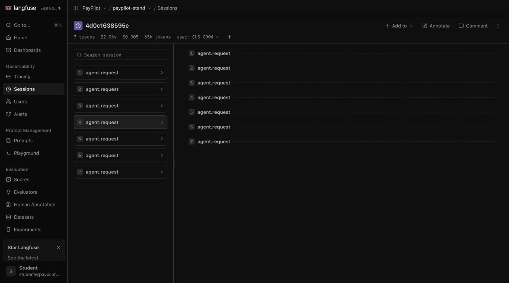
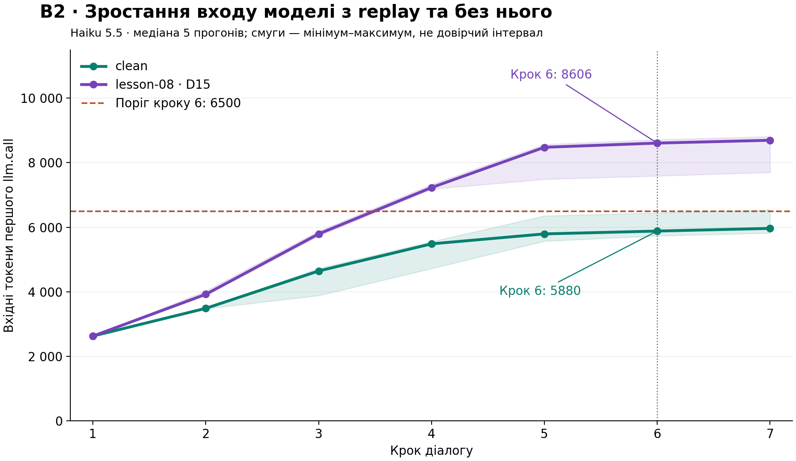

# Observability & Cost Report · PayPilot / Verta

**Авторка:** Lidiia. **Редакція:** 2026-11-12, після зауважень ментора. Система PayPilot, промпт base.v1, stand від 74f1995 із транспортним виправленням. Моделі anthropic/claude-haiku-5.5 та google/gemini-2.5-flash, OpenRouter. Langfuse 4.69.0 та OTLP. Вимірювання B1–B4: 9–10 листопада, по 5 прогонів на комірку B4. Останній повний набір: 11 листопада, по 5 прогонів release-кейсів і один daily.

Прайс вимірювань [prices.json](prices.json) від 2026-10-23: Haiku $0.10/$0.50 та Gemini $0.30/$2.50 за мільйон input/output. Вартість включає кеш і reasoning за відповідними категоріями. Дані провайдера означають provider.cost_usd у спанах, не окремий платіжний інвойс. Ціна діалогу — сума його платних генерацій, для B3 включно з summarize. Час — сума duration_ms кореневих кроків. Медіани рахуються після сумування всередині кожного діалогу.

## Слайд 1 · Трейс проти лічильника

**Сесія C07 у Langfuse:** сім кроків незалежного clean-прогону №5 C07-BUDGET, сесія 4d0c1638595e. Ціна інтерфейсу округлена до $0.005, точне значення атрибута UI $0.004776. Тривалість сесії UI 22.06 с має іншу сферу вимірювання, ніж сума кореневих спанів. Походження: [звіт C07](../reports/l05_dialogs-clean-20261110T183514.json). Це саме сценарій C-07/B2.

**Сесія.** B2 — сім кроків у межах однієї сесії. У JSON збережено всі кроки. Додано власний Raw-скриншот D15 саме кроку 6 (`lab-additions/screenshots/03-d15-step6-raw-input.jpg`). Окремі два власні скриншоти Sessions із сімома трейсами й ціною показують контрольний C08 після виправлення, а не B2. Навчальні ілюстрації викладача не подаються як власний доказ.

### Карта сліпих зон

| Лічильник / перевірка | Що показує | Що насправді | Звідки правда |
|---|---|---|---|
| `usage.cost_usd`, D14 | Нижчу суму | Повтори не повністю враховані | Усі `llm.call` + `provider.cost_usd` на тих самих спанах |
| Затримка кроку, D15 | Майже без погіршення | У промпті повторно додано результати інструментів | Raw Input, `(context replay)`, token usage |
| Сума лише `llm.call`, B3 | Ціну без стиснення | `agent.summarize` — окрема платна генерація | Додати її вартість і звірити з провайдером |
| Langfuse без Model Definition | `no cost` | Генерація була платною | Usage + ціна провайдера; потім налаштування всіх 5 категорій |
| Поріг D15 6500 на Gemini | PASS навіть із дефектом | Інший токенізатор; replay є в 5/5 | Модельний baseline та вхід генерації |
| Заборона іншого reason_code в усьому тексті | FAIL у clean | Інший код може стосуватися іншої транзакції в умовній пораді | Ручне зіставлення ID, коду та контексту; суддя L09 |
| Трейс | Які дії виконані | Не встановлює, які дії були обов'язковими | Вимоги, бізнес-правила й окрема оцінка якості |

### Розбір інциденту B3

Користувач просив перевірити два списання TechMart Online по 240 EUR, визначити причину та строк оскарження. Сутності, які мають зберегтися: `TX-0401`, 240 EUR, `duplicate_charge`, дата 2026-07-20, 60-денне вікно, дедлайн 2026-09-18.

| Крок | Спан | Що записано | Де розійшлося |
|---|---|---|---|
| 1–2 | `tool.get_transactions`, `tool.check_dispute_eligibility` | Правильні ID, сума, код і строк | Початкові дані наявні |
| 3 | `agent.summarize`, span `f74eadecea85626a`, trace `f0e45c20fb0b9f90aa55dcd11a237d67` | На вході є `TX-0401`, 240 EUR і `duplicate_charge`; на виході немає ID/суми, з'являється `service_not_rendered` | Перше підтверджене розходження у збереженому пересказі; згадка duplicate-charge поруч не усуває суперечність |
| 4 | trace `52ea1a4cb6b6f93a3692635d7d5f3057` | Нові `get_account`, `get_transactions`, `check_dispute_eligibility`; потім відповідь із правильними ID/сумою | Дані відновлено додатковими зверненнями |

**Одним реченням для регулятора:** у спані `agent.summarize` кроку 3 первинні дані справи були у вході, але ID і сума зникли з пересказу та змінилося формулювання причини; на кроці 4 агент повторно отримав дані через інструменти.

У п'яти дефектних B3: ID відсутній у 4/5 пересказів, точний код `duplicate_charge` — у 5/5; в одному пересказі сума змінилася на 180 EUR. Усі п'ять повторно викликали `get_transactions` на кроці 4; baseline — жодного інструмента на цьому кроці. Перевірка `summary_contains`: baseline 5/5, defect 0/5. Це перевірка збереження сутностей, не повна оцінка тексту.

**Візуальний доказ B3:** [вхід і вихід agent.summarize на одному екрані](lab-additions/screenshots/04-b3-summarize-input-output.jpg). Видно точні TX-0401, 240 EUR, duplicate_charge на вході та втрату ID/суми й суперечливий service_not_rendered на виході.

### Ціна з трьох джерел

Гроші за діалог; значення нижче — медіани п'яти прогонів. «Провайдер» означає поле вартості генерацій, не платіжний інвойс. Для B1 використано комірки Haiku B4; для B2 — початкову серію B2; для B3 — повні ціни з summarize.

| Сценарій | Умова | Самозвіт системи | Сума спанів | Дані провайдера | Звірка |
|---|---|---:|---:|---:|---|
| B1 / Haiku | baseline | $0.000333 | $0.000333 | $0.000333 | Збіг |
| B1 / Haiku | D14 | $0.000473 | $0.001781 | $0.001781 | Usage пропускає частину ціни |
| B2 / Haiku | baseline | $0.004621 | $0.004620 | $0.004620 | Різниця округлення |
| B2 / Haiku | D15 | $0.006781 | $0.006780 | $0.006780 | Вартість зросла без retry |
| B3 / Haiku | baseline | $0.002278 | $0.00309963, разом із summarize | $0.00309963 | Usage і сума лише llm.call неповні |
| B3 / Haiku | defect | $0.002857 | $0.00311588, разом із summarize | $0.00311588 | Дешевий пересказ не дав економії діалогу |

Для B3 самозвіт округлено до 6 знаків; суми спанів пораховано за точними полями провайдера. Медіану ціни стиснення не додаємо до медіани інших генерацій: спочатку складаємо все всередині кожного діалогу.

**Звірка Langfuse після налаштування.** Trace `0d5e54b2c9fab5b4c01ebc6be5ed139b`: дві генерації $0.00033595 і $0.00009354; разом $0.00042949. Langfuse `costDetails.total` збігся з провайдером на кожній генерації. Перша створює кеш, друга читає його. Налаштовано `input`, `output`, `input_cached_tokens`, `input_cache_creation_tokens`, `output_reasoning_tokens`; правило `(?i)^anthropic/claude-haiku-5\.5$`. Нові генерації отримали ціни; перерахунок старих не заявляється.

### Ціна сценарію B2 / Haiku: перша серія 5+5

Графік показує медіану п’яти прогонів на кожному кроці; смуги — мінімум–максимум, не довірчий інтервал. 70 вихідних значень і назви results.json — у `lab-additions/b2-first-call-input-raw.csv`, підсумки — у `lab-additions/b2-first-call-input-summary.csv`. Зростання саме по собі нормальне; дефект доводиться додатковим replay в Raw Input та різницею нахилів.

| Показник | Норма / clean | Поточний дефектний профіль lesson-08 | Співвідношення |
|---|---:|---:|---:|
| Вхідні токени, медіана | 61 901 | 81 088 | ×1.310 |
| Час кроків, медіана | 26.372 с | 26.175 с | ×0.993 |
| Ціна, медіана | $0.004620 | $0.006780 | ×1.468 |

На кроці 6 медіани першого входу — 5880 clean та 8606 defect при порозі 6500. У defect replay активний із кроку 2 в 5/5; retry немає. Вхід trace `c9d29c4a0e33a7ebed01a042b9e58da8` містить `(context replay)` на 5329 символів; результати рахунку й транзакцій повторюють дані вже наявних повідомлень tool. Різниця вартості між живими умовами включає також варіативність відповідей та інструментів; це не ізольований причинний ефект лише D15.

### Розрахунок неповного визначення моделі

Для B3 span f74eadecea85626a: 1168 input, 123 output і 143 output_reasoning_tokens. Лише input/output дали б $0.00017830; усі відра — $0.00024980, точно як поле provider.cost_usd. **Заниження — $0.00007150, або 28,62%.** Для двох генерацій зі створенням/читанням кешу повна сума $0.00042949, неповна $0.00009010 (заниження 79,02% саме цього запиту). Це власний офлайн-розрахунок, а не цифри репетиції викладача.

Повні відра, формули й хеші джерел — у [розрахунку](lab-additions/pricing-buckets-calculation.md) та відповідному JSON. У Langfuse input вже виключає кеш, output виключає окреме reasoning; не переносимо цю формулу без адаптації на API total input/output.

## Слайд 2 · Прогноз

Формули та припущення наведено нижче.

| Поверх | Значення / приклад | Походження |
|---|---|---|
| Спан | Haiku $0.00033595 зі створенням кешу; $0.00009354 із читанням | Виміряно на двох генераціях одного запиту |
| Сценарій | Haiku B1 $0.000333, B2 $0.004269 | Медіани B4 baseline, по 5 прогонів |
| Місяць | Haiku $24.22; Gemini $32.56 | Розрахунок для 800 користувачів із припущень нижче |
| Прогноз | Haiku $302.76; Gemini $406.96 | N=10000, незмінний мікс і довжини; лише LLM-виклики |

| Припущення | Значення | Джерело |
|---|---:|---|
| Користувачі Start | 800 | Навчальний масштаб Verta, не виміряні активні користувачі |
| Діалогів на користувача за місяць | 20 | Ілюстративне припущення; статистики звернень не надано |
| Мікс | 70% B1, 30% B2 | Ілюстративне припущення, не результат стенда |
| Довжини | B1: 2; B2: 7 кроків | Виміряні сценарії |
| Базовий режим | clean | Сценарій без ін'єктованих D14/D15; не підтвердження готовності системи |

**Місяць поточної моделі Haiku:** `800 × 20 × (0.70 × 0.000333 + 0.30 × 0.004269) = $24.2208`. Для Gemini за тією самою структурою — $32.5568. Зважена сума медіан — планова типова оцінка, не математичне сподівання рахунку з хвостами. Інфраструктура, зберігання трейсів, ескалації й податки до цих чисел не включені.

**Формула для N:** `N × 20 × Σ(частка сценарію × виміряна медіанна ціна діалогу)`.

**Що росте швидше за N:** якщо зі масштабом діалог подовжується, накопичений replay оплачується у більшій кількості наступних генерацій. За фіксованих довжини й міксу D15 сам по собі росте лінійно з N. Ілюстрація 7→12 кроків без нових інструментів: ще п'ять разів надлишок входу кроку 7; часткова додаткова оцінка replay на B2 — Haiku $0.000802, Gemini $0.001278. Це не повна ціна 12-крокового діалогу; незалежних вимірювань такого діалогу немає. D14 — окремий ризик хвоста; його реальна частота не виміряна.

## Слайд 3 · Рішення

| Важіль | Що дає | Що псується / умова |
|---|---|---|
| Усунути повтори на незмінну порожнечу | Менше викликів, коротші затримки, усунення хвоста D14 | Відрізняти коректну порожнечу від тимчасової помилки; регресія обмеженого retry |
| Усунути дублювання replay | Менше зайвого входу; D15 видно в обох моделях | Зберегти вихідну історію та сутності; не замінювати раннім стисненням |
| Зберігати стабільний префікс промпту | Працює дешевше читання кешу | Порядок складання контексту — контракт; контролювати інвалідацію |
| Стискати історію раніше | Зменшує пересказ | B3 показує втрату справи й повторний пошук; повна медіанна економія не підтверджена |
| Змінити модель | Haiku дешевше за діалог на baseline | Вища затримка; нові пороги та оцінка змісту відповідей |

- **Що обміняли:** у розрахунковому варіанті Haiku — нижчу ціну на більший час діалогу. Бізнес-SLA ще не надано.
- **Чого не робимо:** не схвалюємо міграцію до усунення D14/D15; не зменшуємо поріг стиснення, поки пересказ губить справу; не оголошуємо якість усіх відповідей підтвердженою.
- **За яких умов рішення зміниться:** нові вимірювання після виправлень, калібрування під модель, незалежна перевірка, повна регресія, оцінка тексту; реальний мікс, частота, довжини; зміна тарифу, промпту, кешу або SLA.

### Міграція моделі

Порівняння `google/gemini-2.5-flash` → `anthropic/claude-haiku-5.5`; B1/B2, baseline/defect, п'ять прогонів на комірку. Це міграційний експеримент, а не виконане перемикання продакшну. На стенді Haiku використовувалася й до порівняння.

| Модель | Сценарій | Умова | $ діалогу, медіана (розкид) | Час діалогу, медіана (мін–макс) | Перевірка 1 | Перевірка 2 | Токени input/output, довідково |
|---|---|---|---|---|---|---|---|
| `google/gemini-2.5-flash` | B1 | baseline | $0.000515 ($0.000513–$0.000639) | 3.286 (2.993–5.872) с | tool_called: 5/5 | identical max: 5/5 | 6407 / 77 |
| `google/gemini-2.5-flash` | B1 | defect | $0.010650 ($0.001870–$0.064107) | 31.778 (8.625–92.431) с | tool_called: 5/5 | identical max: 0/5 | 76219 / 712 |
| `google/gemini-2.5-flash` | B2 | baseline | $0.005581 ($0.004660–$0.006918) | 13.531 (11.697–14.595) с | поріг кроку 6: PASS | replay: ні, 5/5 | 31204 / 547 |
| `google/gemini-2.5-flash` | B2 | defect | $0.007662 ($0.007280–$0.009322) | 12.384 (11.382–14.293) с | поріг кроку 6: PASS | replay: так, 5/5 | 39006 / 562 |
| `anthropic/claude-haiku-5.5` | B1 | baseline | $0.000333 ($0.000328–$0.000622) | 4.845 (4.518–4.992) с | tool_called: 5/5 | identical max: 5/5 | 11120 / 252 |
| `anthropic/claude-haiku-5.5` | B1 | defect | $0.001781 ($0.001671–$0.001894) | 18.477 (17.767–19.698) с | tool_called: 5/5 | identical max: 0/5 | 33510 / 1842 |
| `anthropic/claude-haiku-5.5` | B2 | baseline | $0.004269 ($0.004002–$0.005189) | 24.844 (21.127–24.894) с | поріг кроку 6: PASS | replay: ні, 5/5 | 57380 / 2944 |
| `anthropic/claude-haiku-5.5` | B2 | defect | $0.005524 ($0.005204–$0.006738) | 24.194 (23.400–26.036) с | поріг кроку 6: FAIL | replay: так, 5/5 | 70251 / 2989 |

Токенізатори різні: міжмодельне рішення приймається за грошима й часом, а не відношенням токенів. Для B2 поле `passed` усередині результатів кіта відображає лише перевірки окремого прогону; фінальний вердикт береться з агрегатного порогу медіани.

- **Дешевше за діалог:** Haiku B1 baseline — на 35.3%, B2 baseline — на 23.5%. Повільніше відповідно ×1.47 і ×1.84.
- **Що лишилося зеленим:** B1 baseline 5/5 на обох; B2 baseline проходить чинний агрегатний поріг на обох. Повного поведінкового набору на Gemini не проганяли.
- **Що сліпне:** Gemini B2 defect проходить 6500, хоча replay активний у всіх п'яти. Медіани кроку 6 — 2909 clean / 3735 defect; для Haiku — 5776 / 7395. Потрібна модельна калібровка й незалежна перевірка; ще не виконані для Gemini.
- **Хвіст D14:** Gemini — 96,32,8,96,8 однакових викликів на кроці; максимум ціни діалогу $0.064107, приблизно ×124.5 до медіанного B1 baseline. Haiku — 8 у кожному з п'яти. Медіана сама цей хвіст не описує.
- **Рішення:** міграція можлива лише за умов усунення дефектів, придатних модельних бюджетів, поведінкової регресії та прийнятної оцінки тексту/часу. Станом на звіт ці умови не закриті.
- **Невиміряне для судді L09:** тон, повнота пояснення документів, зрозумілість відмов, обґрунтованість ескалації, суперечності та правильність альтернативної поради про іншу транзакцію. Наявність/відсутність виклику сама по собі не встановлює його доречність.

### Бюджети в кейсах

Файл: [sets/l05_dialogs.jsonl](../sets/l05_dialogs.jsonl). Усі ресурсні пороги нижче розраховано **від медіани останнього повного clean-звіту**, не від максимуму: [clean 20261111T220253](../reports/l05_dialogs-clean-20261111T220253.json), 5 прогонів кожного кейса. Модель калібрування — Haiku.

Формула: `ceil(медіана × (1 + запас/100) / 1000) × 1000`. Токени — API input+output за діалог; час — сума тривалостей agent.request за діалог, у мс. Звичайний запас 20%. Для токенів C10 запас 25%: найбільше відхилення в clean-серії становило 21,41% медіани. Це вибір на калібрувальній вибірці, не гарантія стабільності й не бізнес-SLA. Округлення додатково збільшує фактичний запас.

| Кейс | Медіана токенів | Запас | tokens_total | Медіана часу, мс | Запас | latency_ms | gate / runs |
|---|---:|---:|---:|---:|---:|---:|---|
| C07-BUDGET | 66425 | 20% | 80000 | 23220 | 20% | 28000 | release / 5 |
| C08-BUDGET | 48864 | 20% | 59000 | 26283 | 20% | 32000 | release / 5 |
| C09-BUDGET | 32086 | 20% | 39000 | 20052 | 20% | 25000 | release / 5 |
| C10-BUDGET | 72598 | 25% | 91000 | 34083 | 20% | 41000 | release / 5 |
| C11-BUDGET | 57678 | 20% | 70000 | 19690 | 20% | 24000 | release / 5 |
| C12-BUDGET | 40904 | 20% | 50000 | 15152 | 20% | 19000 | release / 5 |

**C13-D14-BUDGET**: identical_tool_calls_max=1, daily/runs=1. Ресурсних tokens_total і latency_ms він не задає: це детермінована перевірка рівня 1. Додавання ресурсних меж вимагало б release/runs=5 за правилом L07. Назва+аргументи порівнюються в межах кожного кроку, не між різними кроками.

### Перевірка перерахованих меж

Нові пороги перевірено тим самим evaluator._budget на збережених значеннях обох останніх профілів. Це **офлайн-переоцінка, а не новий живий прогін**. [Машинний результат](../reports/budget-reassessment-20261112.json), [формули й вибірки](calibration.json).

| Кейс | clean у межах | lesson-08 у межах |
|---|---:|---:|
| C07-BUDGET | 5/5 | 0/5 |
| C08-BUDGET | 5/5 | 1/5 |
| C09-BUDGET | 5/5 | 3/5 |
| C10-BUDGET | 5/5 | 4/5 |
| C11-BUDGET | 5/5 | 2/5 |
| C12-BUDGET | 5/5 | 5/5 |

**C07:** медіана clean 66425 × 1,20 = 79710, після округлення tokens_total=80000. Медіана часу 23220 × 1,20 = 27864, після округлення latency_ms=28000. Збережений максимум clean 75084 вкладається в новий токенний ліміт. Усі п’ять збережених clean проходять обидва ліміти; усі п’ять lesson-08 перевищують токенний ліміт (мінімум 84243). Старий звіт із FAIL при 70000 залишається первинним доказом і не переписаний. Незалежний новий clean C07 із новими межами ще потрібен для живого підтвердження.

### Калібрування C07: три варіанти

Медіани останніх серій: clean 66425 токенів, lesson-08 84738 токенів, по 5 прогонів. Тут порівнюється лише tokens_total, окремо від часу та якості відповіді.

| Поріг tokens_total | clean у межах | lesson-08 у межах | Оцінка |
|---|---:|---:|---|
| 65000 | 1/5 | 0/5 | Надто тісний, відхиляє звичайний clean-розкид |
| 100000 | 5/5 | 5/5 | Надто вільний, пропускає D15 |
| 80000 | 5/5 | 0/5 | Медіана clean +20%, округлення вгору |

### Результати повного набору та межі рішення

Первинні повні прогони: [clean 8/12](../reports/l05_dialogs-clean-20261111T220253.json) і [lesson-08 5/12](../reports/l05_dialogs-lesson-08-20261111T213817.json). Обидва --gate all завершилися, 112 діалогів і 794 трейси Haiku. Після прогонів стенд повернуто на clean. Ці числа стосуються попередніх ресурсних меж, а не нового set_hash. Їх не замінюємо результатом офлайн-переоцінки.

D14: clean PASS 1/1, lesson-08 FAIL, 8 однакових викликів. Quality FAIL H01/H02/H04 збережено: основний код TX-0401 у спірних відповідях правильний, але умовна порада про інший TX спричиняє формальну заборону іншого коду. Зміст альтернативної поради потребує оцінки L09. Пороги Gemini D15, строк зберігання та доступ до повних входів/виходів не підтверджені. Зелений release не заявляється.
